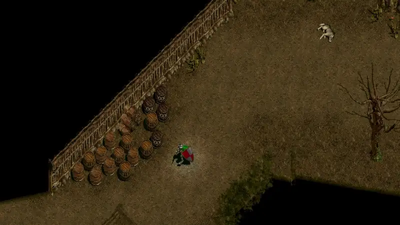
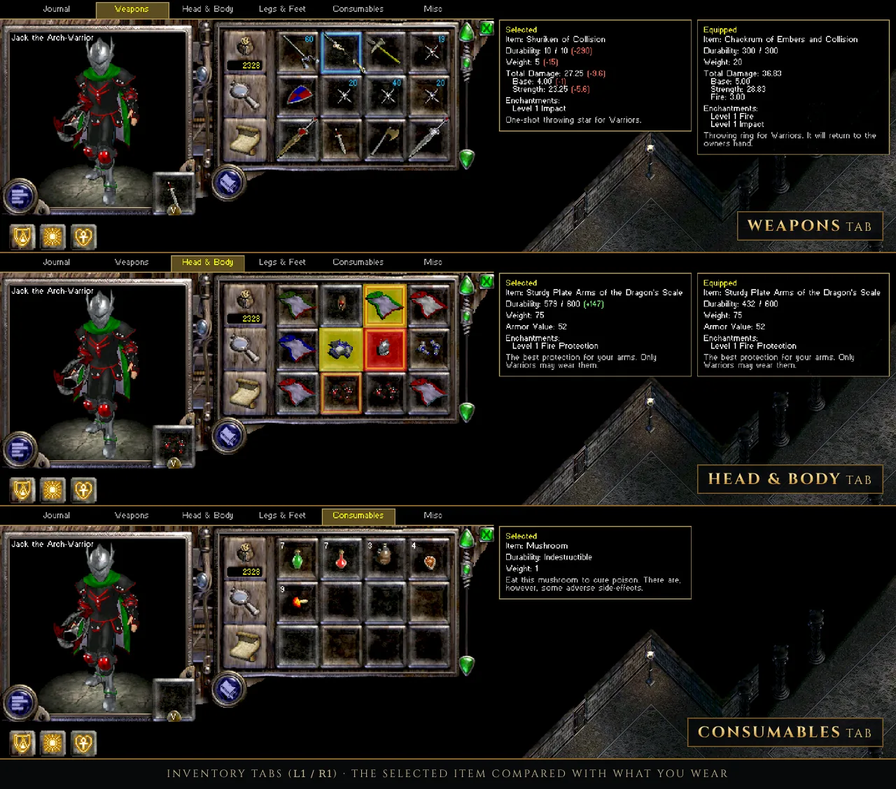
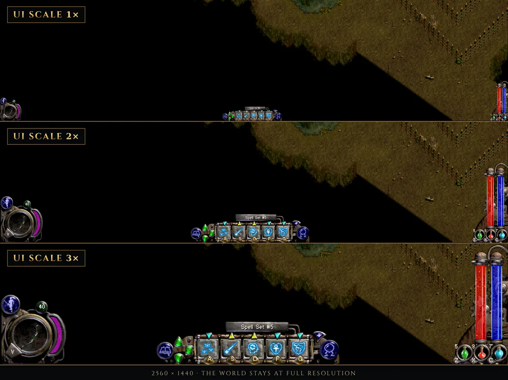
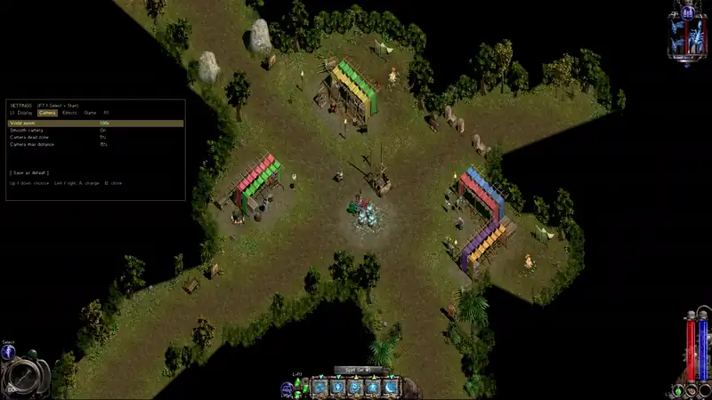

# Nox Modernized

An unofficial mod for **Nox** (Westwood Studios, 2000) that brings the original game up to date: full gamepad play,
modern resolutions, a sharp UI scale, world zoom, a smooth camera, high frame rates and a set of fixes. It runs the
**original GOG `Game.exe`** with two replacement DLLs, so the game itself stays exactly as it was. It also runs on
Android through [Winlator](https://github.com/brunodev85/winlator).

> Nox Modernized is a fan project. It is not affiliated with or endorsed by Electronic Arts, Westwood Studios or GOG.
> You need your own copy of Nox from GOG; no game files are included.

## Features

**Gamepad (XInput)**
- The whole game on a gamepad: move with the left stick, attack and cast with lock-on aiming, every action assignable.
- Menus, dialogues, shops, the inventory and the book of knowledge are worked with the pad through the game's own
  windows.
- Inventory tabs (L1 / R1), item comparison panels, a consumables wheel (L3) and conjurer creature orders.
- Hold <kbd>Select</kbd> in the game for the full list of gamepad controls, hold <kbd>L1</kbd> for the L1 combinations;
  the HUD shows the pad buttons next to its own buttons (gamepad hints, can be switched off).
- The right stick moves a mouse cursor when you need one.

**Graphics** (Nox Modernized's own Direct3D 11 renderer)
- Any resolution from 1024x768 up to 3840x2160, or your desktop size; borderless full screen or a window.
- **UI scale**: the HUD, inventory and menus drawn bigger while the world stays at full resolution, up to what the
  resolution allows (1920x1080: 2.25x, 2560x1440: 3x, 3840x2160: 4.5x).
- **World zoom** (numpad <kbd>+</kbd> / <kbd>-</kbd> / <kbd>*</kbd>, or hold <kbd>R3</kbd> and push the right stick)
  with Lanczos, bicubic or bilinear filtering.
- **High frame rate**: 60, 90 or 120 pictures a second; the game itself keeps its 30 ticks, the camera and moving
  units are smoothed between them.
- Smooth (dampened) camera, sprite / wall / floor edge smoothing, gentler fire light flicker, adjustable map darkness.
- PNG screenshots (<kbd>Print Screen</kbd>).

**Comfort and fixes**
- An in-game settings menu (<kbd>F7</kbd>, or <kbd>Select</kbd> + <kbd>Start</kbd>) whose changes show at once.
- A settings tool (`NoxModernized-Settings.exe`) with an explanation for every setting, a button mapper with
  gamepad detection, and a Play button.
- Rolling autosaves (the last three are kept), an adjustable carry weight limit, beneficial spells such as Lesser
  Heal castable on allies.
- A fix for a bug of the original game: a force shield was lost about a second after loading a save.

## Requirements

- **Nox from GOG**, version 1.2 (installer `setup_nox_1.2_gog_v2_(93536).exe`; its `Game.exe` is dated 2000-07-21,
  MD5 `62cce922af5f6b5a02109d45859a738d`). The settings tool checks this when it sets the game up. Other versions may
  work partly: the mod checks the game's code before every change and leaves out what does not match.
- **Windows 10 or 11** with a Direct3D 11 graphics card, **or** an Android device with **Winlator** (the Ludashi
  build is recommended).
- A gamepad is optional; keyboard and mouse work as in the original game.

## Installing (Windows)

1. Install Nox from GOG (version 1.2) and start it once.
2. Download the latest release and unpack it into **a folder of its own**, for example `C:\Games\NoxModernized`.
   **Do not unpack it into the Nox folder.**
3. Start **`NoxModernized-Settings.exe`**. On its first start it finds your Nox folder (or asks you for it), checks
   the game, and copies `Game.exe` from there into the mod's folder. Your Nox folder is not changed.
4. Choose your resolution and other settings, then **Save**.
5. Press **Play** in the settings tool, or start **`Launch.bat`**.

Always start the game with Play or `Launch.bat`, not with `Game.exe`: they make the game use your Nox folder's data
and saves. Saves are shared with the plain game.

To uninstall, delete the mod's folder. Nothing else was changed.

## Installing on Android (Winlator)

1. Copy your Nox folder (the GOG install) to the device, for example to `D:\Nox` as Winlator sees it.
2. Copy the Nox Modernized folder next to it.
3. In Winlator, start `NoxModernized-Settings.exe` from the mod's folder. It asks for the Nox folder and sets
   everything up, this time for `Launch-Winlator.bat`.
4. Press **Play** in the settings tool, or start **`Launch-Winlator.bat`**.

Winlator uses its own settings file (`nox-modernized-winlator.ini`) with lighter defaults (bicubic filter, no edge
smoothing). On a phone or tablet, a resolution such as 1280x800 with 1.5x to 2x world zoom keeps 60 frames a second
on recent devices. You can also edit the Winlator settings on a PC: the settings tool's file selector at the top
switches between the two files.

## Default gamepad controls

All of these can be changed in the settings tool (Buttons page), per class.

| Button | In the game |
|---|---|
| Left stick | move (push lightly to walk) |
| Right stick | mouse cursor (push firmly) |
| A | attack / use (aims at the nearest enemy in front) |
| R1 (hold) | aim in place |
| R3 | talk / trade / pick up |
| L3 | consumables wheel |
| X / Y / B | spell or ability slots 1-3 |
| L1 + X / Y / B | slots 3-5 |
| LT | jump |
| RT | quick save |
| D-pad up / down | health potion / swap weapons |
| D-pad left / right | map / next spell set |
| L1 + D-pad up / down | mana potion / cure poison |
| L1 + R1 | previous spell set |
| L1 + A | trap (wizard) / bomber (conjurer) |
| Select | inventory (hold: all gamepad controls) |
| L1 + Select | book of knowledge |
| Start | pause menu |
| Select + Start | Nox Modernized settings |
| R3 (hold) + right stick | world zoom |

Conjurer: D-pad right gives creature orders, the next spell set is on L1 + RT. The warrior has no spell sets, mana or
traps, so those combos are free for him.

In menus, the inventory and shops: D-pad or left stick to choose, A to press, B to go back, L1 / R1 for tabs.

## Keyboard extras

| Key | |
|---|---|
| F7 | Nox Modernized settings |
| Numpad + / - / * | world zoom in / out / back to 1x |
| F8 | frame counter |
| Print Screen | screenshot (into `Screenshots` next to `Game.exe` in the mod's folder) |
| Insert / Delete | brightness (the game's own, also in F7) |

The pause menu (<kbd>Esc</kbd>) shows these, and the gamepad ones, in a box beside it.

## Testing and known limitations

- The single-player game has been tested extensively with a gamepad, on Windows and on Android with
  Winlator (Ludashi build).
- **Multiplayer has not been tested.** Online and LAN play use the original game's networking and may work, but
  expect problems. One known limit: as a client in someone else's game, the gamepad still picks and marks targets
  from your own view, but it cannot wait until your character has turned to face the enemy, so arrows and thrown
  weapons fired straight after locking on may miss more often.
- Spells aimed at a spot land where the enemy was when the cast ended (no leading), as with the mouse.

## Building from source

The source code is in the `src` folder of the GitHub repository. It is plain C, built with MinGW-w64 (32-bit) on
Linux or in MSYS2; see [docs/BUILDING.md](docs/BUILDING.md).

The other files in `docs` (`01-input.md` to `04-game-notes.md`) are working notes on the game's internals:
addresses, structures and findings. They were written for an AI coding assistant during development, so they are
terse and not really meant for human reading. They are included in case you want to continue or improve the project
yourself, with or without an AI's help.

## Credits

- **proxydllvines**: author. Nox Modernized was written with the help of Claude (Anthropic).
- **[OpenNox](https://github.com/noxworld-dev/opennox)** (noxworld-dev): its reverse engineering of Nox was the
  reference for finding the game's functions, addresses and structures. No OpenNox code is included.
- **Westwood Studios** made Nox; it is owned by **Electronic Arts** and sold by **GOG**.

## Licence

Nox Modernized is free software under the [GNU General Public License v3.0](LICENSE). Nox and its data are not part
of this project and remain the property of their owners.
